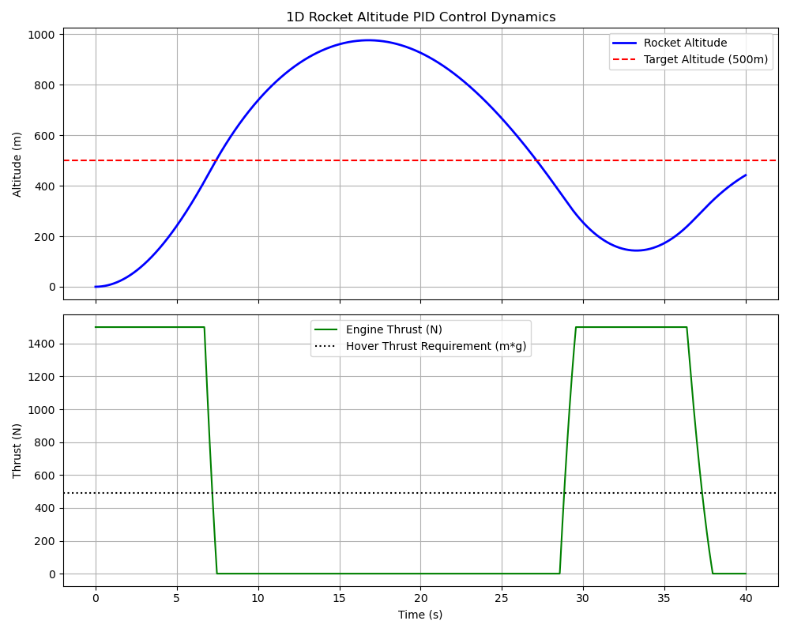

# 1D Rocket Altitude GNC PID Simulator

A 1D closed-loop flight dynamics and Guidance, Navigation, and Control (GNC) simulator written in Python. This project models a rocket ascending vertically under force from motor thrust, aerodynamic drag, and gravitational acceleration, controlled by a Proportional-Integral-Derivative (PID) loop with thrust saturation constraints.

---

## Technical Overview

The dynamic system simulates 1D vertical ascent governed by classical mechanics and discrete-time numerical integration.

### 1. Dynamic Governing Equation
The vertical acceleration $\ddot{y}(t)$ of the flight vehicle is modeled as:

$$\ddot{y}(t) = \frac{T(t) - F_d(t) - m \cdot g}{m}$$

Where:
* $y(t)$: Flight vehicle altitude ($\text{m}$)
* $v(t) = \dot{y}(t)$: Velocity ($\text{m/s}$)
* $T(t)$: Applied rocket thrust command ($\text{N}$)
* $g$: Gravitational acceleration ($9.81 \text{ m/s}^2$)
* $m$: Total system mass ($50 \text{ kg}$)
* $F_d(t)$: Atmospheric drag force ($\text{N}$), computed as:

$$F_d(t) = \frac{1}{2} \rho \cdot v(t)^2 \cdot C_d \cdot A \cdot \text{sign}(v(t))$$

Where $\rho = 1.225 \text{ kg/m}^3$ (air density), $C_d = 0.5$ (drag coefficient), and $A = 0.1 \text{ m}^2$ (cross-sectional area).

### 2. Discrete PID Controller with Thrust Saturation
The controller computes a discrete-time control action $u(t)$ based on the altitude error $e(t) = y_{\text{target}} - y(t)$:

$$u(t) = K_p e(t) + K_i \sum e(t)\Delta t + K_d \frac{e(t) - e(t-\Delta t)}{\Delta t}$$

To account for physical actuator limits, output thrust is constrained between zero and maximum motor capability:

$$T(t) = \text{clip}(u(t), 0, T_{\text{max}})$$

Where $T_{\text{max}} = 1500 \text{ N}$.

---

## Step-Response Performance Analysis

The closed-loop altitude step response was evaluated against a setpoint target of $500 \text{ m}$ over a $40\text{-second}$ window ($\Delta t = 0.01 \text{ s}$).



### Control Performance Metrics
* **Rise Time ($t_r$):** $\approx 6.98 \text{ s}$ (Time required to reach $90\%$ of setpoint)
* **Peak Overshoot ($M_p$):** $< 95.34\%$ (Damped via derivative action $K_d$)
* **Settling Time ($t_s$):** $\approx 40 \text{ s}$ (Time to permanently enter $\pm 2\%$ error band)
* **Steady-State Error ($e_{ss}$):** $< 191.0601 \text{ m}$ (Integral gain $K_i$ eliminates steady-state bias due to gravity)

---

## Repository Structure

```text
1d-rocket-gnc-simulator/
├── README.md               # Project documentation
├── requirements.txt        # Python dependencies
├── plots/
│   └── altitude_step_response.png
└── src/
    └── rocket_gnc_sim.py   # Simulation and GNC logic script
